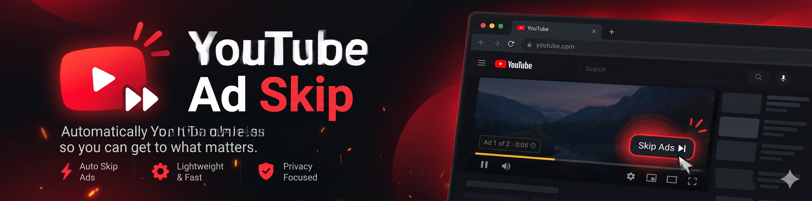

<p align="center">
  
</p>

<h1 align="center">YouTube Ad Skip</h1>

<p align="center">
  A lightweight Chrome extension that automatically clicks YouTube's <strong>Skip Ads</strong> button when a skippable ad becomes eligible for skipping.
</p>

<p align="center">
  
  
  
  
  
  
  
</p>

<p align="center">
  
</p>

## Table of Contents

- [Overview](#overview)
- [Features](#features)
- [Roadmap](#roadmap)
- [Tech Stack](#tech-stack)
- [How It Works](#how-it-works)
- [Project Structure](#project-structure)
- [Getting Started](#getting-started)
- [Build and Package](#build-and-package)
- [Privacy and Permissions](#privacy-and-permissions)
- [Limitations](#limitations)

## Overview

YouTube Ad Skip is a browser extension designed to reduce the need to manually press **Skip Ads** while watching YouTube in a supported desktop browser.

When Auto Skip is enabled, the extension checks the YouTube page for an available, visible skip control and clicks it when it can identify the correct button. It does not create a separate video player or replace YouTube's playback experience.

The project is built with WXT and Manifest V3, with React and TypeScript for the popup interface. It is designed to run locally in the browser without requiring an account, an application server, a database, or an AI API key.

## Features

- **Automatic skipping:** Click the available YouTube Skip Ads button when it can be detected reliably.
- **On/off control:** Enable or disable Auto Skip from the extension popup.
- **YouTube-focused behavior:** Run the page integration on YouTube rather than unrelated websites.
- **Saved preference:** Remember the Auto Skip setting using local extension storage.
- **Activity feedback:** Show the extension state and keep a count of skip-button actions.
- **Lightweight setup:** Develop and install locally without a hosted backend.

## Roadmap

### Phase 1 — Extension Setup and Popup Preferences

- [ ] Configure the WXT project with Manifest V3, extension metadata, and the YouTube content-script entrypoint.
- [ ] Build the popup interface with React, Tailwind CSS, and Lucide React.
- [ ] Add the Auto Skip toggle and enabled/disabled status.
- [ ] Save and restore the user's preference with `chrome.storage.local`.

### Phase 2 — YouTube Player Integration and Detection

- [ ] Restrict the content script to YouTube pages.
- [ ] Read the saved Auto Skip preference in the content script and respond when it changes.
- [ ] Attach to the YouTube player and respond to in-site video navigation.
- [ ] Identify the actual Skip Ads control exposed by YouTube's current player DOM.
- [ ] Detect that control only while an ad is showing and the button is visible and enabled.

### Phase 3 — Automatic Skipping and Activity Tracking

- [ ] Click the detected Skip Ads control only when Auto Skip is enabled.
- [ ] Prevent duplicate clicks and avoid interacting with unrelated player controls.
- [ ] Track successful skip-button actions.
- [ ] Display the activity count in the popup.

### Phase 4 — Runtime Reliability and Popup Feedback

- [ ] Keep the popup's preference and activity information synchronized with the content script.
- [ ] Handle missing players, unavailable controls, and storage errors without disrupting the page.
- [ ] Clean up observers and stale references when YouTube replaces player elements or changes videos.
- [ ] Provide clear active, inactive, and error states and refine popup keyboard accessibility.

## Tech Stack

| Technology | Purpose |
| --- | --- |
| [WXT](https://wxt.dev/) | Extension framework, build tooling, development reloads, and packaging. |
| [Chrome Extensions Manifest V3](https://developer.chrome.com/docs/extensions/develop/migrate/what-is-mv3) | Extension configuration, permissions, and browser integration. |
| [React](https://react.dev/) | Build the popup interface from reusable components. |
| [TypeScript](https://www.typescriptlang.org/) | Add static typing to UI and extension logic. |
| [Tailwind CSS](https://tailwindcss.com/) | Style the popup interface. |
| [Lucide React](https://lucide.dev/) | Provide consistent interface icons. |
| [pnpm](https://pnpm.io/) | Manage packages and run project scripts. |
| Chrome Extensions API | Store preferences and connect the popup with extension functionality. |

## How It Works

1. The popup lets the user turn Auto Skip on or off.
2. The preference is stored locally by the extension.
3. A content script runs on matching YouTube pages and observes relevant player interface changes.
4. When Auto Skip is enabled, the script checks for a visible and enabled Skip Ads button that it can identify.
5. The extension clicks that button and updates its activity feedback.

YouTube's page structure can change over time, so element detection will be designed to fail safely when the correct control cannot be identified.

## Project Structure

```text
youtube-ad-skip/
├── assets/
│   ├── banner.png                # README project banner
│   └── logo.png                  # README project logo
├── components/                  # Reusable React UI components
├── entrypoints/
│   ├── popup/
│   │   ├── App.tsx               # Popup interface
│   │   ├── main.tsx              # Popup React entry
│   │   ├── index.html            # Popup HTML entry
│   │   └── style.css             # Popup styles and Tailwind imports
│   └── youtube.content.ts        # YouTube content script
├── public/                       # Static files copied to the output
├── utils/                        # Shared helper functions
├── wxt.config.ts                 # WXT and manifest configuration
├── package.json                 # Scripts and dependencies
├── pnpm-lock.yaml               # Locked dependency versions
└── tsconfig.json                # TypeScript configuration
```

WXT generates the final browser manifest and build output from the project configuration and entrypoints. Some generated starter files may have slightly different names depending on the selected template.

## Getting Started

### Prerequisites

- [Node.js](https://nodejs.org/) 22 or newer
- [pnpm](https://pnpm.io/installation)
- Google Chrome desktop

### Install Dependencies

Clone or download the repository, open a terminal in the project directory, and run:

```bash
pnpm install
```

### Start Development

```bash
pnpm dev
```

WXT builds the development version and normally opens a browser with the extension loaded. Keep the terminal running while developing so WXT can rebuild and reload supported changes.

If you need to load the development build manually, open `chrome://extensions`, enable **Developer mode**, choose **Load unpacked**, and select the development output directory generated by WXT (usually `.output/chrome-mv3-dev`).

## Build and Package

Create a production build:

```bash
pnpm build
```

Create a ZIP package:

```bash
pnpm zip
```

WXT writes the production output and ZIP package to its generated output directory. To test the production build locally, open `chrome://extensions`, enable **Developer mode**, choose **Load unpacked**, and select the production output directory (usually `.output/chrome-mv3`).

## Privacy and Permissions

- Settings are intended to be stored locally using the browser's extension storage API.
- The extension does not require an account, a custom backend, a database, or an AI API key.
- Website access should be limited to the YouTube pages needed for its feature.
- Permissions should be kept to the minimum required for content-script access and local preference storage.
- The extension should interact only with the Skip Ads control it can identify and should not collect unrelated page content.

## Limitations

- The extension can only click a Skip Ads button when YouTube makes that control available and the page exposes it in a detectable form.
- Non-skippable ads cannot be skipped by clicking a button that is not present.
- YouTube may change its UI or page structure, which can require updates to detection logic.
- This is a browser extension for YouTube in a supported desktop browser. It does not run inside the native YouTube mobile app.
- The extension triggers YouTube's available skip control; it is not an ad blocker and does not remove or bypass every advertisement.
